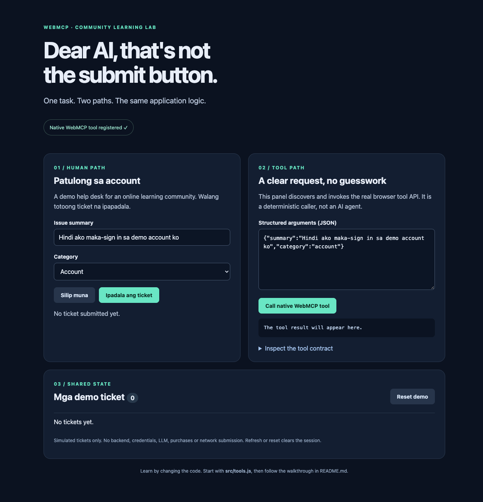

# webmcp

## Dear AI, That's Not the Submit Button

A runnable companion to Andre's WebMCP talk. A support form and a structured tool both call the **same validated application function**.

- Plain HTML, CSS and JavaScript. No framework, API key, npm install, backend account or LLM required.
- A real `document.modelContext.registerTool()` integration when the browser supports it.
- An explicitly labeled rehearsal handler when it does not. **Rehearsal is not native WebMCP.**
- Synthetic tickets remain in memory in the current tab. Nothing is sent to a help desk.

The setting is a fictional Philippine online learning community. The interface uses a few familiar Filipino phrases alongside clear English technical labels. The sample request is “Hindi ako maka-sign in sa demo account ko.” There are no real student records, names or contact details.



## Quick start

Install [Node.js](https://nodejs.org/) 22 or later (tested with Node 24), then:

```sh
git clone https://github.com/andresitodeguzman/webmcp.git
cd webmcp
npm start
```

Open **http://localhost:4173**. In a second terminal:

```sh
npm run check
```

There are no package dependencies to install. Stop with Ctrl+C. Use `PORT=5000 npm start` on macOS/Linux if port 4173 is occupied. On PowerShell use `$env:PORT=5000; npm start`.

Open the cloned folder in Codex or your editor to follow the code. If you use nvm, `nvm use` selects the Node 24 version in `.nvmrc`.

## Native browser setup

WebMCP is experimental, not a universally available web standard. This example targets the current `document.modelContext` API and the Chrome 155+ object-argument calling convention. Check the [official setup instructions](https://developer.chrome.com/docs/ai/webmcp) for your installed build.

For local development, the documented setting is `chrome://flags/#enable-webmcp-testing`. Enable it in a disposable development browser profile and relaunch. Open the localhost URL again. Do not turn off browser security checks or add secrets to this demo. Managed browsers may disallow experimental flags.

Look for **“Native WebMCP tool registered”** and **“Call native WebMCP tool.”** If you see “Rehearsal mode,” the normal UI still works, but browser-mediated tool execution is not being demonstrated. Older examples using `navigator.modelContext` or `unregisterTool()` do not match this project's target API. We intentionally do not install a fake browser API or silently retry mutations using legacy argument formats.

The native panel uses `getTools()` and `executeTool(tool, args)`; it is a deterministic caller, **not an AI agent**. A real agent can discover this same tool through a compatible browser integration. An LLM is unnecessary for teaching the contract.

## Five-minute stage walkthrough

1. **Set the problem (30 sec).** “The page has a Preview button and a Submit button. A tool should express the task, not guess a coordinate.” This is an illustration, not a measured claim that an agent fails here.
2. **Show the human path (45 sec).** Click **Silip muna** (preview only): zero tickets. Click **Ipadala ang ticket** (submit ticket): `DEMO-001` appears. The human UI remains a first-class interface.
3. **Reveal the contract (60 sec).** Expand **Inspect the tool contract**. Point out the name, description, required fields and enum. Open `src/tools.js` and follow `execute` into the shared `submit` function.
4. **Call the tool (60 sec).** Click **Reset demo**. In the tool panel use:

   ```json
   {"summary":"Hindi ako maka-sign in sa demo account ko","category":"account"}
   ```

   Click the native tool button. The shared ticket list updates and JSON is returned. If using rehearsal mode, say so out loud.
5. **Demonstrate limits (45 sec).** Repeat the call: `duplicate: true`, still one ticket. Set the summary to `bad`: validation fails and no new ticket appears. The schema is useful guidance; application validation is still necessary.
6. **Close (60 sec).** Rename the human button in `index.html`, reload and repeat the tool call. The semantic contract has not changed. It still depends on correct application logic, permissions, validation and a compatible browser.

For a real-agent rehearsal, use a compatible tool inspector/agent from the official Chrome docs and ask: “Create a demo account-support ticket: Hindi ako maka-sign in sa demo account ko.” Verify the agent discovers `submit_demo_ticket`, uses those exact arguments, receives a successful result and creates one visible ticket. The optional extensions can have separate installation, model, key and data-sharing requirements; they are not bundled or required here.

## Follow the code

```text
Human form ──> submit(input) ──> store.submit(input) ──> render()
Tool call  ──> execute(input) ──> submit(input)        ──> JSON result
```

- `index.html`: ordinary accessible form, tool panel and shared ticket list.
- `src/domain.js`: input validation, in-memory state and session deduplication.
- `src/tools.js`: tool descriptor, execution result and abortable registration.
- `src/app.js`: binds both paths to the same function; detects support honestly.
- `server.mjs`: loopback-only static server with an explicit file allowlist.
- `test/unit.test.mjs`: application and registration contract tests.
- `test/http.test.mjs`: server assets, headers, routing and source-file isolation.
- `test/browser.mjs`: optional Chromium desktop/mobile smoke test.
- `docs/EXERCISES.md`: audience challenges with acceptance criteria.
- `docs/VERIFICATION.md`: what was actually tested and what remains to rehearse.

## What this is, and is not

This is the proposed browser WebMCP API, not a standalone MCP server with an HTTP/stdio transport. It exposes page-local application behavior in an active document. There is no remote model, background agent loop, persistent session or deployed service in this repository.

This example uses the **imperative** API. The emerging declarative form API is another approach, but deliberately left out to keep one working path easy to follow.

| | This WebMCP example | A backend MCP integration |
| --- | --- | --- |
| Tool lives in | The active browser document | A separate MCP server |
| State here | The same ticket store the human UI uses | State maintained by the service |
| Invocation | Browser tool discovery and execution | An MCP client connected to the server |
| Useful for | Cooperative work on an open web page | Service operations independent of that page |

They can complement each other. This repo teaches the page-local path; it does not implement an MCP transport. See the [proposal's explanation of both flows](https://github.com/webmachinelearning/webmcp#backend-integrations-vs-in-browser-webmcp-tools).

Tool metadata and annotations are hints, not authorization or security controls. Never put secrets in tool descriptions or results. Treat user text as untrusted data, never as instructions. In a real ticketing service, authenticate and authorize on the server, validate there, rate-limit, implement durable idempotency and confirm consequential actions. This toy's content-based deduplication is not a production idempotency strategy.

Only synthetic demo data is used. No permissions, credentials or account settings are needed.

## Tests

```sh
npm run check           # Syntax + Node unit and HTTP tests
npm run test:browser    # Optional: installed Chromium required
```

Set `CHROME_BIN` to your Chrome/Chromium executable if it is not named `chromium`. The optional test starts its own server at port 4184 and a disposable profile, then checks disabled/enabled WebMCP modes, duplicate calls, malformed JSON, validation, HTML escaping, reset, reload, screenshots and mobile overflow. Native tests require a build that exposes WebMCP using the configured experimental flag. It deliberately fails rather than counting rehearsal as a native pass. It does not install a browser or dependencies. Screenshot outputs go to ignored `artifacts/`.

For example, on macOS with Microsoft Edge installed:

```sh
CHROME_BIN="/Applications/Microsoft Edge.app/Contents/MacOS/Microsoft Edge" npm run test:browser
```

On Neo, all nine automated tests and both browser modes passed with Node 24.15.0 and Edge 157.0.4341.42. The native browser test uses `--enable-blink-features=WebMCP` in a disposable profile; it leaves the normal browser profile unchanged. The panel is a deterministic caller, so a real LLM agent's discovery and choices still need a separate rehearsal. See [the verification record](docs/VERIFICATION.md) and [audience exercises](docs/EXERCISES.md).

## Sources and API snapshot

Reviewed against official documentation on **9 November 2026**. Experimental APIs can change; recheck before the event.

- [Chrome WebMCP setup and overview](https://developer.chrome.com/docs/ai/webmcp)
- [Chrome imperative API: registration, discovery, execution and lifecycle](https://developer.chrome.com/docs/ai/webmcp/imperative-api)
- [Web Machine Learning Community Group proposal](https://github.com/webmachinelearning/webmcp)
- [Draft specification](https://webmachinelearning.github.io/webmcp/)
- [Chrome security guidance](https://developer.chrome.com/docs/ai/webmcp/secure-tools)

The demo code is written for this example, not copied from a third-party demo. No open-source license is selected in this draft; the repository owner should choose one before inviting code reuse beyond normal GitHub viewing/forking rights.
